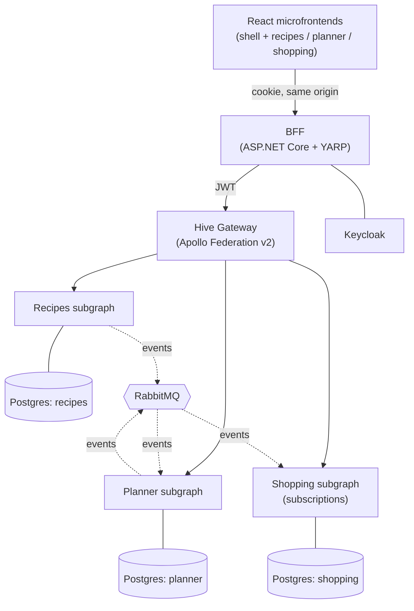

# Meal Planner

A household meal planner built as a **learning project** that covers modern full-stack development end to end. You save recipes, plan the week's dinners, and get an auto-generated shopping list that everyone in the household can check off live.

> An app this size would normally be a modular monolith. Here it's split into microservices and microfrontends **on purpose**, so that every architectural lesson has a real place to happen. See [ADR 0001](docs/adr/0001-why-microservices.md).

## What it covers

| Area           | Choices                                                                                                   |
| -------------- | --------------------------------------------------------------------------------------------------------- |
| Backend        | .NET 10, Hot Chocolate GraphQL subgraphs (Apollo Federation v2), Clean Architecture, EF Core + PostgreSQL |
| Gateway / edge | Hive Gateway (federation router), ASP.NET Core BFF (OIDC cookie auth, YARP)                               |
| Messaging      | RabbitMQ + MassTransit 8 (transactional outbox and inbox)                                                 |
| Auth           | Keycloak (OIDC), multi-tenancy per household                                                              |
| Frontend       | React + TypeScript microfrontends (Module Federation 2.0, Rsbuild), Apollo Client, GraphQL Codegen        |
| Design system  | shadcn/ui + Tailwind tokens, Storybook (interaction, a11y and visual tests)                               |
| Caching        | HTTP, Apollo cache, gateway response cache, HybridCache (memory + Redis), DataLoader                      |
| Security       | GraphQL hardening (trusted documents, cost limits, signed subgraph requests), CodeQL, Trivy, SBOM, cosign |
| Local dev      | .NET Aspire                                                                                               |
| Platform       | Docker, Kubernetes (kind), Helm, Gateway API (Envoy Gateway), operators, Argo CD (GitOps)                 |
| Observability  | OpenTelemetry, Grafana LGTM, SLOs                                                                         |
| IaC            | OpenTofu                                                                                                  |
| CI/CD          | GitHub Actions, release-please, Renovate                                                                  |

Everything uses free and open-source tools.

## Architecture

## Roadmap

The work is tracked as epics and task issues on the [GitHub Project board](https://github.com/Fryderyk90?tab=projects). There is one milestone per epic:

| Milestone | Epic                                  |
| --------- | ------------------------------------- |
| M0        | Foundations and engineering practices |
| M1        | Walking skeleton                      |
| M2        | Recipes domain                        |
| M3        | Design system and Storybook           |
| M4        | Auth and tenancy                      |
| M5        | Planner and federation                |
| M6        | Shopping                              |
| M7        | Real-time                             |
| M8        | Testing and quality                   |
| M9        | GraphQL security hardening            |
| M10       | Caching                               |
| M11       | Containers and supply chain           |
| M12       | Kubernetes                            |
| M13       | Delivery: GitOps and releases         |
| M14       | Operations and reliability            |
| M15       | Infrastructure as code (OpenTofu)     |
| M16       | Product polish (optional)             |

## Prerequisites

- [.NET 10 SDK](https://dotnet.microsoft.com/download)
- Node.js 22+ and pnpm
- Docker Desktop (WSL 2 backend on Windows)
- From M12 on: `kind`, `kubectl`, `helm`, `tofu`

## Architecture decisions

These are recorded as ADRs. The index is in [`docs/adr/README.md`](docs/adr/README.md).

## Contributing

See [CONTRIBUTING.md](CONTRIBUTING.md) for the workflow, branch and commit conventions, the PR checklist, and when to write an ADR.

## License

[MIT](LICENSE)
